# Zamanla

[](https://github.com/ErenBirsin/zamanla/actions/workflows/ci.yml)

Berber, kuaför ve güzellik salonları için çok kiracılı (multi-tenant) online randevu uygulaması. Salon sahibi hizmetlerini, personelini ve çalışma saatlerini panelden yönetir; müşteriler salonun kendine ait linkinden giriş yapmadan randevu alır.

## Ekran görüntüleri

Müşteri telefondan randevuyu onaylar onaylamaz randevu salonun takviminde belirir ve zil yeni bildirimi gösterir; panelde sayfa yenilenmez.

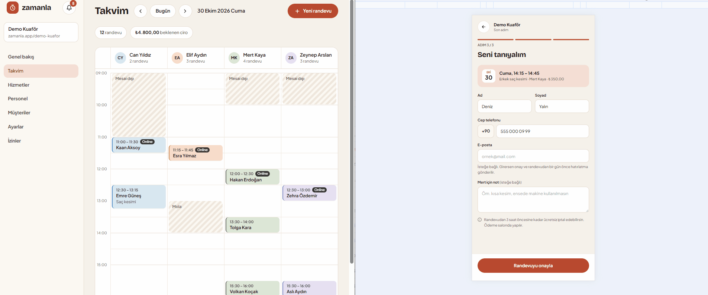

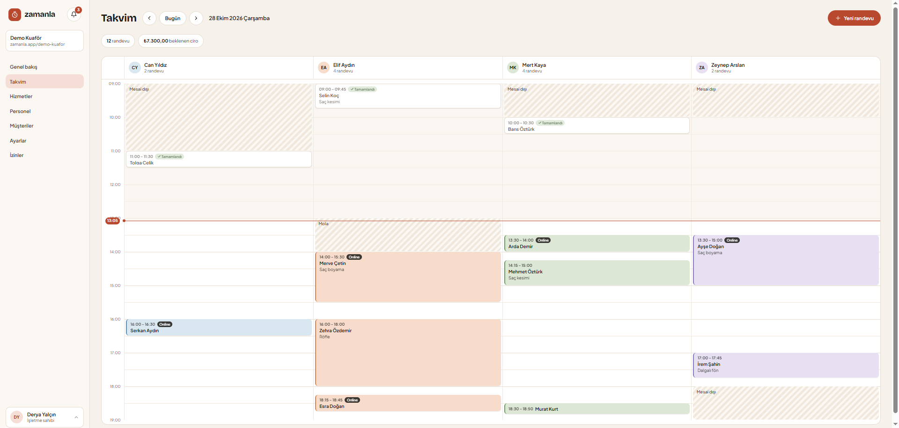

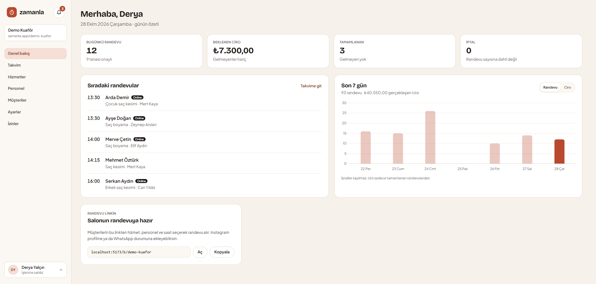

<p align="center">
  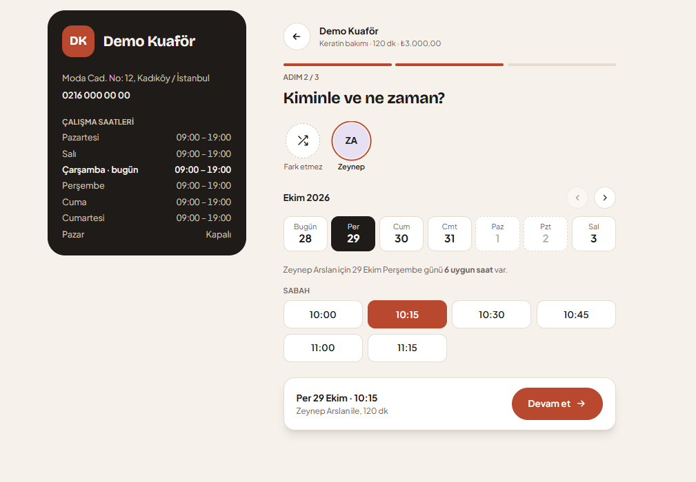
  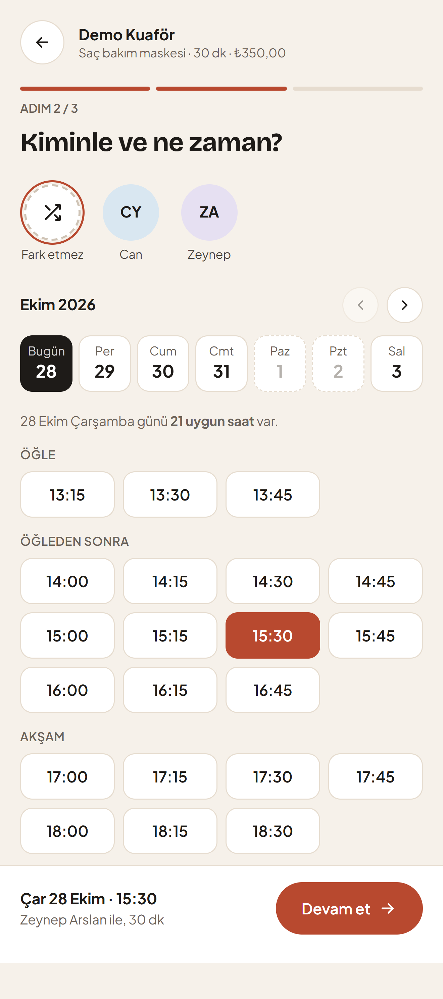
</p>

<details>
<summary>Daha fazla ekran görüntüsü</summary>

**Giriş sayfası**

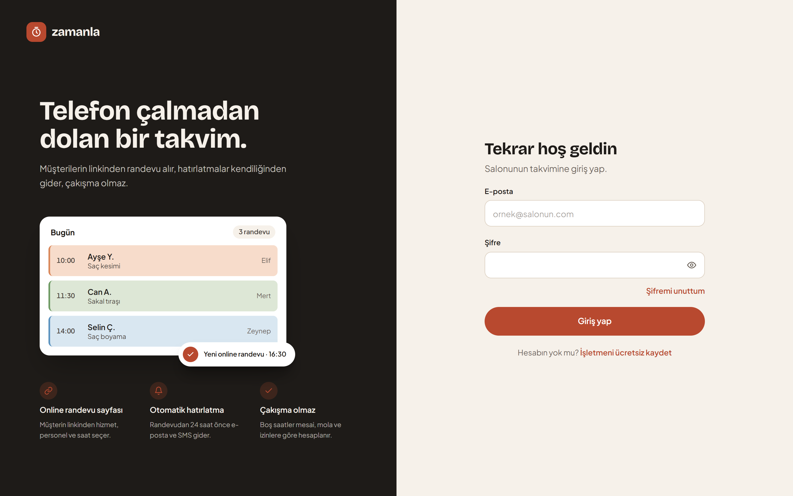

**Online randevu: hizmet seçimi ve son adım**

<p align="center">
  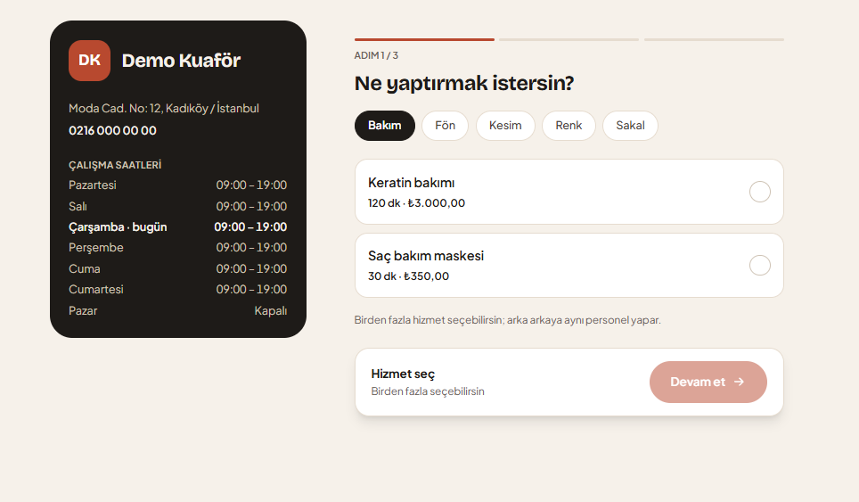
  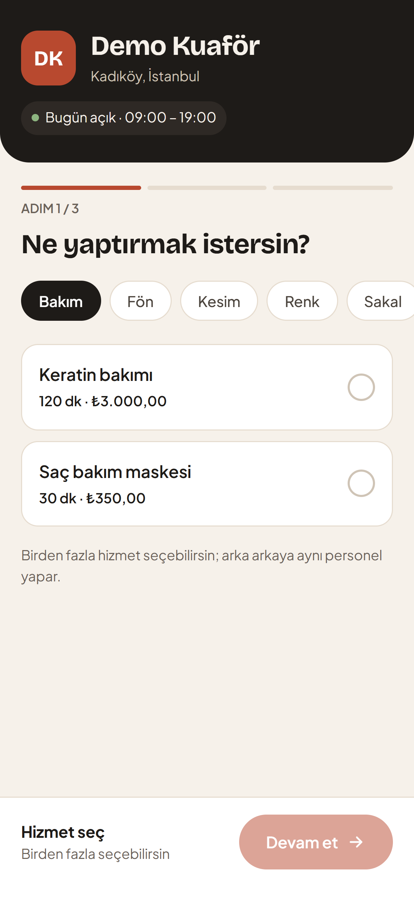
</p>
<p align="center">
  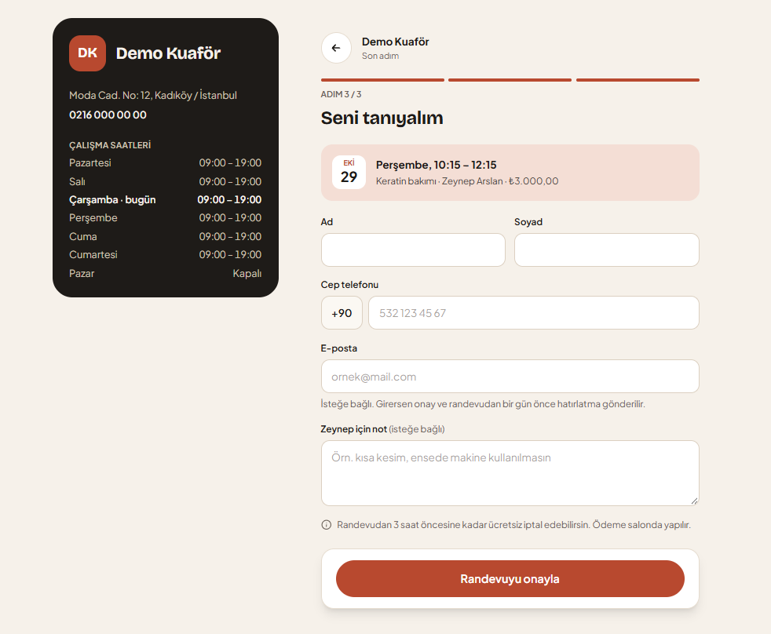
  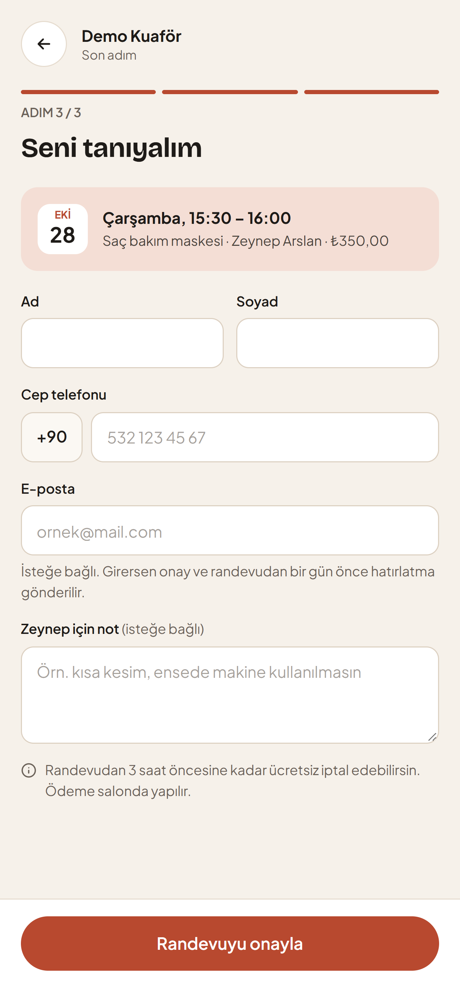
</p>

**Randevu yönetim sayfası: takvime ekleme, saat değiştirme ve iptal**

<p align="center">
  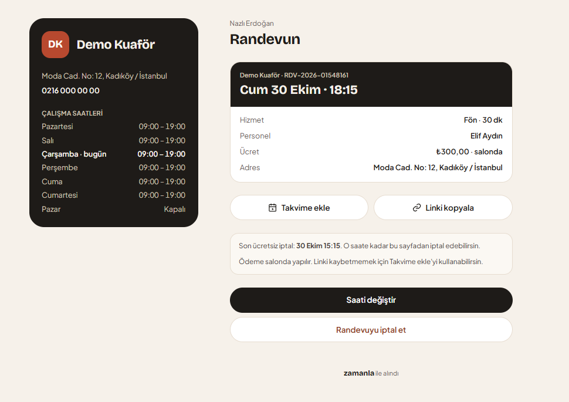
  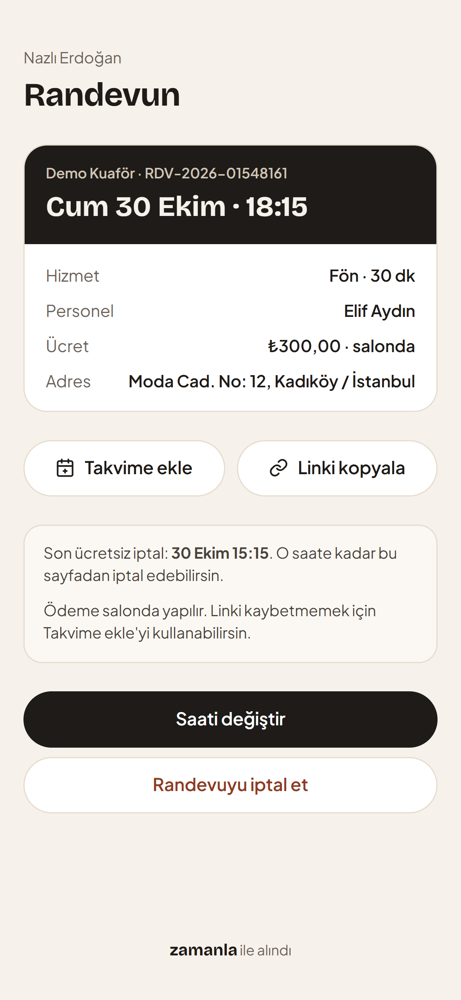
</p>

</details>

## Özellikler

### Salon paneli

- İşletme kaydı ve giriş. Her salonun verisi diğerlerinden ayrı tutulur.
- Şifremi unuttum ve şifre değiştirme: sıfırlama linki e-postayla gelir; panelden mevcut şifreyle yeni şifre belirlenir. Şifre alanlarında göster/gizle düğmesi ve şifre gücü göstergesi vardır.
- Genel bakış: bugünün randevu sayısı, beklenen ciro, tamamlanan, gelmeyen ve iptal edilen randevular, sıradaki randevular ve son 7 günün randevu ve ciro grafiği. Takvim değişince sayfa yenilenmeden güncellenir.
- Hizmetler: süre, hazırlık payı, fiyat ve kategori.
- Personel: verdiği hizmetler ve haftalık çalışma saatleri. Aynı güne öğle arası gibi birden fazla aralık girilebilir.
- Müşteriler: isim ya da telefonla arama. Silinen müşterinin kişisel bilgileri KVKK'ya uygun şekilde anonimleştirilir; ileri tarihli randevusu olan müşteri, randevuları iptal edilmeden silinemez.
- Günlük takvim: personel sütunları, mola, mesai dışı ve kapalı saatler, izinler, "şu an" çizgisi ve geçen saatlerin soluk gösterimi. Randevu ya da izin değişince sayfa yenilenmeden güncellenir.
- Randevular: birden fazla hizmet, tamamlandı / gelmedi / iptal / yeniden planlama ve randevu geçmişi.
- İzinler: personel izni ve bayram gibi salonun kapalı olduğu günler, tüm gün ya da saat aralığıyla.
- Bildirimler: müşteri online randevu alınca, linkten iptal edince ya da saatini değiştirince zil ile haber verilir; okunmamış sayısı ve okundu işareti tutulur.
- Ayarlar: salon adı, adres, telefon ve online randevu kuralları.
- Personel hesapları: salon sahibi personeli e-postayla gönderilen davet linkiyle panele çağırır, yetkilerini personel başına seçer ve hesabı pasif yapabilir. Yetkisi olmayan personel takvimi görür, müşteri ekler ve kendi randevularını yönetir; genel bakıştaki ciro, ayarlar ve diğer yönetim ekranları yetkiye göre açılır.
- Panel telefon ekranına da uyum sağlar: menü üst çubuktaki ☰ düğmesiyle açılır, listeler kart olarak görünür. Veriler yüklenirken sayfanın iskeleti, API'ye ulaşılamazsa "Tekrar dene" kartı gösterilir; silme gibi işlemler onay penceresiyle sorulur.

### Müşteri tarafı

- Salonun linkinden (`/b/salon-adi`) hizmet, personel ve saat seçerek randevu alma. Sayfa telefon için tasarlandı.
- Randevuyu görüntüleme, iptal etme ve saatini değiştirme için kişiye özel yönetim linki.
- Randevuyu telefonun takvimine ekleme (.ics, 1 saat önce hatırlatma).
- Salon adres ve telefon girdiyse randevu sayfasında ve randevu linkinde gösterilir; telefon tıklanınca arama başlar.
- Randevu alınınca onay, randevudan 24 saat önce hatırlatma gönderilir. E-posta girildiyse e-postayla, ayrıca SMS ile (SMS sağlayıcısı henüz bağlı değil; mesajlar API'nin log'una yazılır). E-postalar ortak bir HTML şablonla gider; online randevunun onay e-postasında yönetim düğmesi vardır.

### Kurallar ve güvenlik

- Boş saatler çalışma saatlerine, molalara, izinlere ve diğer randevulara göre 15 dakikalık adımlarla hesaplanır.
- Onaylı randevusu olan bir aralığa izin ya da kapalı gün girilemez; etkilenen randevular listelenir.
- Aynı saate aynı anda gelen iki randevudan yalnızca biri kaydedilir.
- Online randevu kuralları her salon için ayarlardan değiştirilebilir: kaç gün ilerisi (varsayılan 60), linkten saat değiştirme ve iptal için son süre (varsayılan 3 saat) ve aynı telefonla en fazla ileri tarihli randevu (varsayılan 5).
- Yönetim, davet ve şifre sıfırlama linklerindeki anahtarlar veritabanında açık haliyle değil, SHA-256 özetiyle saklanır. Davet linki 7 gün, şifre sıfırlama linki 1 saat geçerlidir; ikisi de bir kez kullanılabilir.
- Şifre en az 8 karakter olur, büyük ve küçük harf, rakam ve özel karakter içerir; Türkçe harfler de sayılır. Kural hem formda hem API'de uygulanır.
- Şifremi unuttum ekranı e-posta kayıtlı olsun olmasın aynı cevabı verir. Şifre değişince ya da sıfırlanınca diğer cihazlardaki oturumlar kapanır.
- Yetkiler her istekte veritabanından okunur; yetki geri alınınca ya da hesap pasif yapılınca hemen geçerli olur, pasif hesabın açık oturumları kapanır. Başka personelin randevusu için ayrı yetki gerekir. Ciro yetkisi olmayan personele genel bakıştaki ciro toplamları API'den hiç gönderilmez; tek tek randevuların fiyatı ise randevu detayında görünür.
- JWT access token (15 dk) ve refresh token (14 gün). Çıkış yapınca o cihazın refresh token'ı sunucuda da silinir. Kullanılmış bir refresh token tekrar gelirse açık oturumlar kapatılır. Süresi dolan token'lar günde bir silinir.
- Panel birden fazla sekmede açıksa token yenileme sekmeler arasında sırayla yapılır; bir sekmede çıkış yapılınca diğer sekmeler de oturumu kapatır.
- E-posta ya da SMS gönderilemezse randevu yine oluşturulur. Hatırlatma bir sonraki turda tekrar denenir.
- Giriş, kayıt ve herkese açık uçlarda IP bazlı istek sınırı.
- Canlı güncellemeler sadece salonun kendi paneline gider ve veri taşımaz; panel değişen veriyi yetkili uçlardan yeniden çeker.

## Mimari ve teknolojiler

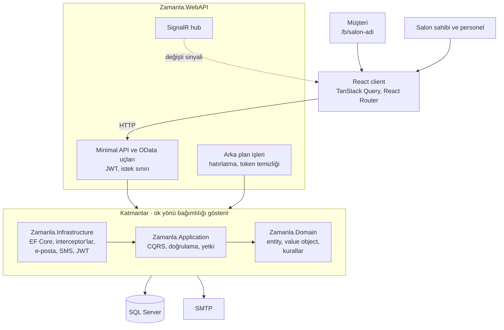

### Backend

- **Mimari:** Clean Architecture (Domain, Application, Infrastructure, WebAPI)
- **Desenler:** CQRS, Result, Repository, Unit of Work, `[Permission]` etiketiyle yetki kontrolü
- **.NET 10, ASP.NET Core Web API:** Minimal API modülleri ve OData uçları
- **Entity Framework Core + SQL Server:** veri erişimi, global query filter ile salon ve silinmiş kayıt ayrımı
- **TS.MediatR:** CQRS ve pipeline davranışları için
- **TS.Result:** standart sonuç modeli için
- **TS.EntityFrameworkCore.GenericRepository:** genel amaçlı repository işlemleri için
- **FluentValidation:** istek doğrulama için
- **Scrutor:** servislerin otomatik kaydı için
- **JWT Bearer:** kimlik doğrulama için
- **FluentEmail (SMTP):** e-posta gönderimi için
- **BackgroundService:** hatırlatmalar ve token temizliği için arka plan işleri
- **SignalR:** canlı takvim ve bildirimler için
- **Scalar:** API dokümantasyonu ve deneme için

### Frontend

- **React 19, TypeScript, Vite**
- **Tailwind CSS:** arayüz
- **TanStack Query:** sunucu verisi ve önbellek
- **React Router:** sayfa yönlendirme
- **React Hook Form + Zod:** form ve doğrulama
- **Zustand:** oturum durumu
- **Axios:** API istekleri, token yenileme
- **@microsoft/signalr:** canlı güncelleme bağlantısı
- **Chart.js (react-chartjs-2):** genel bakıştaki grafik

### Test ve CI

- **xUnit v3, Shouldly:** birim ve entegrasyon testleri
- **WebApplicationFactory + Respawn:** gerçek SQL Server üzerinde, her testten önce temizlenen veritabanı
- **GitHub Actions:** her push ve PR'da backend testleri (SQL Server container ile) ve client lint, Prettier biçim kontrolü ve build

## Öne çıkan teknik kararlar

- **Tek veritabanında çok kiracılı yapı.** Her kayıtta `TenantId` var. Okumada EF Core global query filter salonun verisini ayırır; yazmada bir interceptor yeni kayda salonu kendisi atar ve başka salonun kaydının değiştirilmesini engeller. Herkese açık sayfalarda salon adresteki slug'dan bulunur.
- **Çakışan randevuyu veritabanı engeller.** Personel kaydında bir concurrency token (`BookingVersion`) var ve her randevu kaydında artar. Aynı saate aynı anda gelen iki istekten ikincisi kaydedilemez, kullanıcıya tekrar denemesi söylenir.
- **Randevu kendi kopyasını tutar.** Hizmetin süresi, hazırlık payı ve fiyatı randevu alınırken randevuya kopyalanır; hizmet sonradan değişse de geçmiş randevu ve ciro değişmez. Personel, hazırlık payı bitene kadar dolu sayılır.
- **Canlı güncellemeler veri taşımaz.** Randevu, izin ya da bildirim kaydedilince bir interceptor salonun SignalR grubuna sadece "değişti" sinyali gönderir; panel veriyi kendi yetkisiyle yeniden çeker. Böylece yetkisi olmayan birine veri sızmaz ve her komuta ayrıca bildirim kodu yazılmaz.
- **Yetkiler token'da değil veritabanında.** Yetkiler her istekte okunur; geri alınan yetki ya da pasif yapılan hesap hemen geçerli olur. Ciro yetkisi olmayan personele genel bakıştaki ciro toplamları arayüzde gizlenmekle kalmaz, API'den de gönderilmez.
- **Linklerdeki anahtarlar özetle saklanır.** Randevu yönetimi, davet, şifre sıfırlama ve refresh token'lar veritabanında SHA-256 özetiyle tutulur; veritabanı sızsa bile linkler kullanılamaz.
- **Zaman tek yerden.** Saatler UTC saklanır, salonun saat diliminde gösterilir. Kod saati `TimeProvider` üzerinden okur, böylece zamana bağlı kurallar test edilebilir.
- **Testler gerçek veritabanında.** Entegrasyon testleri sahte bir veritabanı yerine SQL Server üzerinde çalışır ve her testten önce Respawn ile temizlenir; CI'da da SQL Server container'ı kullanılır.

### Online randevu takvime nasıl düşer

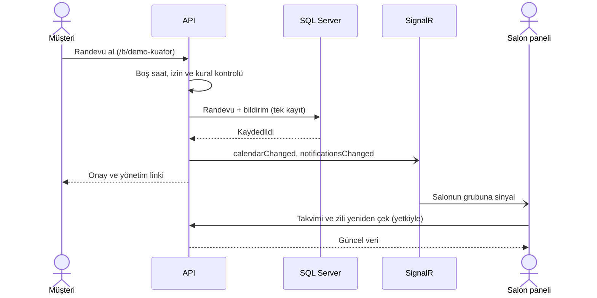

## Kurulum

### Gerekenler

- [.NET 10 SDK](https://dotnet.microsoft.com/download)
- [Node.js 24](https://nodejs.org)
- SQL Server (Express yeterli). Örneklerde `.\SQLEXPRESS` kullanılıyor.

### 1. Depoyu klonla

```bash
git clone https://github.com/ErenBirsin/zamanla.git
cd zamanla
```

### 2. HTTPS geliştirme sertifikasına güven

```bash
dotnet dev-certs https --trust
```

### 3. Gizli ayarları User Secrets'a ekle

Bağlantı cümlesi ve JWT anahtarı repoda tutulmaz, her geliştiricinin kendi bilgisayarındaki User Secrets'ta durur.

```bash
dotnet user-secrets set "ConnectionStrings:SqlServer" "Server=.\SQLEXPRESS;Database=Zamanla;Trusted_Connection=True;TrustServerCertificate=True;" --project src/Zamanla.WebAPI
```

JWT anahtarı en az 64 karakter olmalı. PowerShell'de rastgele bir anahtar üretip ekranda göstermeden kaydetmek için:

```powershell
$bytes = New-Object byte[] 64
[Security.Cryptography.RandomNumberGenerator]::Create().GetBytes($bytes)
dotnet user-secrets set "Jwt:SecretKey" ([Convert]::ToBase64String($bytes)) --project src/Zamanla.WebAPI
```

macOS / Linux için:

```bash
dotnet user-secrets set "Jwt:SecretKey" "$(openssl rand -hex 48)" --project src/Zamanla.WebAPI
```

### 4. Paketleri yükle ve veritabanını oluştur

```bash
dotnet restore
dotnet tool install --global dotnet-ef --version 10.*
dotnet ef database update --project src/Zamanla.Infrastructure --startup-project src/Zamanla.WebAPI
```

### 5. API'yi çalıştır

```bash
dotnet run --project src/Zamanla.WebAPI --launch-profile https
```

API `https://localhost:7080` adresinde açılır, dokümantasyon `https://localhost:7080/scalar` adresindedir. İlk çalıştırmada boş veritabanına demo salon eklenir.

### 6. Client'ı çalıştır

Yeni bir terminalde:

```bash
cd client
npm ci
npm run dev
```

Uygulama `http://localhost:5173` adresinde açılır. Vite, `/api` isteklerini API'ye yönlendirir; bu yüzden API'nin de çalışıyor olması gerekir.

### 7. E-postaları görmek (isteğe bağlı)

Geliştirmede e-postalar `localhost:25`'e gönderilir. Gerçekten gönderilmeden görmek için [smtp4dev](https://github.com/rnwood/smtp4dev) kullanılabilir:

```bash
dotnet tool install --global Rnwood.Smtp4dev --version 3.15.0
smtp4dev
```

Gelen kutusu `http://localhost:5000` adresinde açılır. smtp4dev çalışmıyorsa randevular yine oluşturulur, gönderim hatası log'a yazılır. SMS için henüz bir sağlayıcı yok; mesajlar API'nin log'una yazılır.

## Demo

Geliştirme ortamında API ilk açıldığında "Demo Kuaför" adında dolu bir salon oluşturulur: 12 hizmet (biri pasif), 4 personel, 80 müşteri, son 4 haftanın tamamlanan, gelmeyen ve iptal edilen randevuları, önümüzdeki 2 haftanın randevuları, personel izinleri ve bildirimler. Bütün isimler, telefonlar ve e-postalar uydurmadır. Demo salon zaten varsa tekrar eklenmez.

| Hesap | E-posta | Şifre | Yetki |
| --- | --- | --- | --- |
| Salon sahibi | `demo@zamanla.test` | `Demo12345!` | Her şey |
| Personel (Elif) | `elif@zamanla.test` | `Elif2026!` | İzinleri yönetir |
| Personel (Mert) | `mert@zamanla.test` | `Mert2026!` | Yetkisi yok: takvimi görür, kendi randevularını yönetir |

| | |
| --- | --- |
| Panel | `http://localhost:5173` |
| Randevu sayfası | `http://localhost:5173/b/demo-kuafor` |
| Randevu yönetim sayfası | `http://localhost:5173/b/demo-kuafor/r/demo-randevu` |

Bu hesaplar yalnızca yerel geliştirme içindir.

Yeni bir personel hesabı denemek için Personel sayfasında hesabı olmayan bir personelin "Hesap" düğmesinden davet gönderebilirsin. Link e-postayla gelir (bkz. smtp4dev) ve pencerede de gösterilir; linkten şifre belirleyen personel panele kendi yetkileriyle girer.

Demo verisi kurulduğu güne göre oluşur. Sıfırdan oluşturmak için API'yi durdurup veritabanını silip tekrar kurabilirsin:

```bash
dotnet ef database drop --project src/Zamanla.Infrastructure --startup-project src/Zamanla.WebAPI
dotnet ef database update --project src/Zamanla.Infrastructure --startup-project src/Zamanla.WebAPI
```

## Testler

```bash
dotnet test
```

Entegrasyon testleri gerçek bir SQL Server kullanır. Varsayılan olarak `.\SQLEXPRESS` üzerindeki `Zamanla_Test` veritabanına bağlanır; veritabanı yoksa migration'larla oluşturulur ve her testten önce Respawn ile temizlenir. Geliştirme veritabanına dokunulmaz.

Farklı bir SQL Server kullanmak için bağlantı cümlesini `ZAMANLA_TEST_CONNECTION` ortam değişkeniyle verebilirsin.

## Proje yapısı

```text
src/
├── Zamanla.Domain           Entity'ler, value object'ler, iş kuralları
├── Zamanla.Application      Use case'ler (CQRS), validasyon
├── Zamanla.Infrastructure   EF Core, migration'lar, kimlik doğrulama
└── Zamanla.WebAPI           HTTP uç noktaları, demo verisi
tests/
├── Zamanla.Application.Tests
└── Zamanla.WebAPI.IntegrationTests
client/
└── src/
    ├── features             Sayfa ve özellik bazlı klasörler (auth, calendar, booking...)
    └── shared               Ortak bileşenler, API istemcisi
```

## Yol haritası

- [x] Aşama 0: Proje kurulumu ve CI
- [x] Aşama 1: İşletme kaydı, giriş, JWT ve refresh token
- [x] Aşama 2: Hizmetler, personel ve müşteriler
- [x] Aşama 3: Randevular ve günlük takvim
- [x] Aşama 4: Herkese açık randevu sayfası
- [x] MVP: Kurulum rehberi ve demo verisi
- [x] Aşama 5: v1 katmanı
  - [x] 5.1 Salon ayarları
  - [x] 5.2 Personel izni ve kapalı günler
  - [x] 5.3 Hatırlatmalar (e-posta ve SMS)
  - [x] 5.4 Canlı takvim ve bildirim zili (SignalR)
  - [x] 5.5 Günlük özet
  - [x] 5.6 Personel hesapları ve yetkiler
  - [x] 5.7 Şifre sıfırlama ve şifre değiştirme
- [x] Aşama 6: Vitrin
  - [x] 6.1 Görünüm iyileştirmeleri
  - [x] 6.2 Herkese açık sayfalar
  - [x] 6.3 Demo verisi ve README vitrini
  - [x] 6.4 Son dokunuşlar

Sürüm notları için [CHANGELOG.md](CHANGELOG.md).
